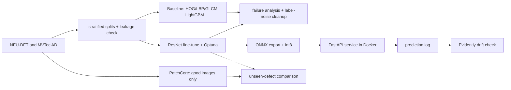

# Surface Defect Inspection Service

An end-to-end ML pipeline for steel-surface defects: a classical-ML baseline, a fine-tuned ResNet, and PatchCore
anomaly detection, with failure analysis, ONNX serving, CI and drift monitoring. The point is *choosing the right
model and proving it*, not defaulting to deep learning.

> **Status:** complete. All sections below are collected from real runs into `reports/RESULTS.md`
> (`python scripts/collect_results.py`); nothing is typed by hand.

## Results

All numbers below are generated from real runs — never typed by hand — by `python scripts/collect_results.py`
into [`reports/RESULTS.md`](reports/RESULTS.md), which also carries the commit sha they came from.

**NEU-DET classification** (model selection on val; test evaluated once, at the end):

| Model | Val macro-F1 | Test macro-F1 |
|---|---|---|
| HOG+LBP+GLCM + LogReg | 0.970 | 0.956 |
| HOG+LBP+GLCM + LightGBM | 0.989 | 0.985 |
| ResNet fine-tuned | 1.000 | 0.996 |

The dataset is easy: every augmentation policy saturates validation (ablation: 1.000 ± 0.000 for all), so the
honest comparison is the test-split gap (+0.011 for the ResNet over LightGBM) and the error analysis. cleanlab
flagged 12 candidate label errors (`reports/label_issues.csv`); manual confirmation is pending by design.

**Anomaly detection (PatchCore, MVTec AD — bottle, metal_nut, capsule; trained on defect-free images only):**

| Category | Image AUROC | Pixel AUROC | Precision@thr | Recall@thr |
|---|---|---|---|---|
| bottle | 1.000 | 0.983 | 0.97 | 1.00 |
| metal_nut | 1.000 | 0.986 | 0.97 | 1.00 |
| capsule | 0.968 | 0.987 | 0.97 | 0.96 |
| **mean** | **0.989** | **0.986** | | |

**Unseen defect types** (leave-one-defect-type-out; the supervised model trains on good images plus half of every
*other* defect type, PatchCore never sees any defect):

- vs a supervised ResNet18 (3-seed ensemble): PatchCore **0.987 vs 0.975** mean AUROC on *unseen* types (+0.012,
  ahead in 6/12 folds, CI excludes 0 in PatchCore's favour in 3, never in the supervised model's favour) and
  statistically tied on *seen* types (0.986 vs 0.988). TPR at 5% FPR: 0.94 vs 0.89 (unseen).
- vs LightGBM on handcrafted features: PatchCore wins **12/12 folds on unseen types** (0.987 vs 0.741) and 12/12
  on seen types (0.986 vs 0.806) — the classical features do not generalise to texture-free colour/shape defects.

**Deployment benchmark** (CPU only, 1 thread — the serving image has no torch/GPU):

| Backend | Size (MB) | p50 (ms) | Throughput (img/s) | Val macro-F1 |
|---|---|---|---|---|
| PyTorch fp32 | 44.8 | 61.6 | 19.2 | 1.000 |
| ONNX Runtime fp32 | 44.7 | 34.4 | 31.6 | 1.000 |
| ONNX Runtime int8 | 11.3 | 20.4 | 52.6 | 0.981 |

int8 is 4x smaller and 3x faster than the PyTorch baseline for −0.019 macro-F1.

**Drift monitoring** (four corruption families x three severities through the served model, Evidently): every
family is detected at severity >= 2 with **no false alert on clean data**, and the report separates *detected but
benign* (mild contrast/noise: F1 drop < 0.05) from *detected and harmful* — an alert means "investigate",
retraining stays a human decision.

**Training performance** (GTX 1660 Ti, this repo's defaults): ResNet fine-tuning went from 336 s/epoch (CPU-only
torch wheel — the Windows `pip install torch` default) to 9.8 s/epoch with the CUDA wheel and pipeline fixes
(~34x); a full 25-epoch early-stopped run takes 42 s. PatchCore's coreset/kNN math runs on GPU with numpy-path
parity (max diff 3.8e-06).

## Architecture


## What this covers
| Job requirement | Where | Status |
|---|---|---|
| Pick the right algorithm, not just deep learning | baseline vs ResNet vs PatchCore | done |
| Feature engineering (classical ML) | `src/features/handcrafted.py` | done |
| Class imbalance, label noise, leakage | balanced weights, cleanlab, perceptual-hash leakage check | done |
| Proper train/val/test, test used once | stratified split, `--eval-test` flag | done |
| Failure analysis, iterate on data | `reports/failure_analysis.md`, `src/evaluate/` | done |
| Hyperparameter tuning | Optuna with pruning, augmentation ablation | done |
| Anomaly detection | PatchCore on MVTec AD, unseen-defect comparison | done |
| Production inference service | ONNX, int8, FastAPI, Docker, latency benchmark | done |
| Experiment tracking | MLflow | done |
| CI/CD | GitHub Actions: lint, tests, end-to-end smoke, Docker | done |
| Drift monitoring | Evidently, simulated corruptions, drift-vs-harm table | done |
| Object detection / segmentation | not built (classification + anomaly maps only) | **gap** |
| Time-series forecasting | not built | **gap** |
| Model registry, registry-based rollback | version directories + `MODEL_DIR` only | **gap** |
| Dataset versioning (DVC) | not built | **gap** |

## Quickstart
```bash
# GPU machine: install the CUDA build FIRST — the plain PyPI torch wheel is CPU-only on Windows.
# Pick the cuXXX index matching your driver (`nvidia-smi` shows the CUDA version); cu130 needs driver >= 580.
pip install torch torchvision --index-url https://download.pytorch.org/whl/cu130
# CPU-only (CI, no-GPU machines): pip install torch torchvision --index-url https://download.pytorch.org/whl/cpu
pip install -r requirements.txt
python -c "import torch; print(torch.cuda.is_available())"   # must print True on a GPU machine
make ci && make smoke                 # lint, tests, end-to-end run on synthetic data
# put NEU-DET under data/raw/NEU-DET and MVTec AD under data/raw/mvtec_ad/<category>, then:
make baseline && make deep
make patchcore && make compare         # MVTec AD categories from configs/patchcore.yaml
mlflow ui --backend-store-uri sqlite:///mlflow.db
```
`RUNBOOK.md` has the full ordered sequence with gates.

## Components

### Baseline and deep model
```bash
make baseline                          # LogReg + LightGBM on HOG/LBP/GLCM features, val only
make deep                              # ResNet fine-tuning
make ablate                            # augmentation ablation, 3 seeds -> artifacts/ablation.md
make tune                              # Optuna -> artifacts/best_params.yaml
python -m src.train.train_deep train --params artifacts/best_params.yaml --eval-test   # final, once
```
Both use the same split seed, so val/test sets are identical across models. The test split is only evaluated with
`--eval-test`.

### Failure analysis and label noise
```bash
make failure-analysis                  # errors -> reports/error_review.csv + montages; label causes by hand
python -m src.evaluate.failure_analysis summarize --pred artifacts/predictions_lightgbm_val.csv
make label-noise                       # cleanlab candidates; confirm by eye -> reports/label_issues_confirmed.csv
python -m src.train.train_baseline --exclude-train reports/label_issues_confirmed.csv
```
Analysis uses validation predictions only. Flagged samples are dropped from train only; val/test labels are untouched.

### Anomaly detection (PatchCore, MVTec AD)
Trains on defect-free images only. NEU-DET has no defect-free images, so this part uses MVTec AD.
```bash
make patchcore                         # categories in configs/patchcore.yaml
```
Per category: `bank.npy`, `meta.json` (with a threshold calibrated on held-out *good train* images),
`results.json` (image/pixel AUROC, per-defect AUROC), `overlays.png`. Differences from the paper: image score is the
max patch distance (no re-weighting) and kNN is exact (no faiss).

### PatchCore vs supervised on unseen defect types
```bash
make compare
```
Leave-one-defect-type-out per category. The supervised model trains on good images plus half of every *other* defect
type; PatchCore never sees defects. Both are scored on identical images: `test/good` plus all of the held-out type
(**unseen**), and plus the untouched other half of the other types (**seen**). Reported: AUROC, TPR at 5% FPR and a
paired-bootstrap CI of the AUROC gap. Caveats: the supervised model sees few defects (they come from the MVTec test
split); eval sets are small so CIs are wide; PatchCore holds out 10% of good train images for its threshold.

### Deployment (ONNX + FastAPI + Docker)
```bash
python -m src.deploy.export_onnx --ckpt artifacts/resnet_best.pt --set-current   # models/<version>/ and models/current/
make benchmark                         # PyTorch vs ONNX Runtime fp32 vs int8: latency, throughput, size, val accuracy
uvicorn src.serve.app:app --port 8000 && curl -F file=@image.jpg localhost:8000/predict
docker build -f docker/Dockerfile -t defect-inspection . && docker run -p 8000:8000 defect-inspection
```
Export verifies ONNX-vs-PyTorch parity (< 1e-3). int8 is static QDQ quantisation calibrated on train images; read
its accuracy column next to the speed-up. Endpoints: `/health`, `/model`, `/predict`, `/predict/batch`.
Rollback = point `MODEL_DIR` at an older `models/<version>/`. The image contains only the runtime (no torch).

### Drift monitoring (Evidently)
```bash
make drift-reference                   # reference.csv inside the model bundle
make drift-simulate                    # blur/brightness/contrast/noise x 3 severities through the service
make drift-check LOG=predictions.jsonl # exit 1 on alert
```
Alert = any column with p < 0.01 / n_columns (K-S numeric, chi-square label); windows under 100 samples get no
verdict. The simulation reports alert *and* the real macro-F1 drop per scenario, because drift is not degradation:
an alert means "investigate". Repeated checks multiply false alarms; retraining stays a human decision.

### Continuous integration
`.github/workflows/ci.yml` on every push to `main` and pull request: `lint-test` (ruff pinned + explicit rules, pytest,
Python 3.11 and 3.12) and `smoke` (`scripts/smoke_pipeline.py`: every stage on synthetic data, then the Docker image is
built, started and probed). The synthetic data is deliberately easy: CI proves the pipeline runs, **not** that the
models are good.

## Evaluation protocol
Stratified 70/15/15 split with a fixed seed. Model selection on val only. Perceptual-hash leakage check between
test and train. The test set is evaluated once per model, at the end.

## Limitations
Classification only (no detection or segmentation, so no mAP); no time-series work; no model registry or dataset
versioning; PatchCore is not served by the API; the unseen-defect comparison has small evaluation sets (wide CIs);
drift simulations are synthetic stand-ins for real-world drift; benchmark numbers are for one specific CPU (12-core
Intel desktop, single-thread ONNX Runtime). NEU-DET is nearly saturated by all three models (val macro-F1 1.00),
so model-choice deltas are smaller than one misclassification — MVTec AD discriminates better. PatchCore runs on
3 of 15 MVTec categories with two documented simplifications (max-patch image score, exact kNN), so its numbers
sit slightly below the paper's full method. Label-noise candidates are flagged but not yet manually confirmed.

## Data and licences
NEU-DET: check the terms of the source you download from. MVTec AD: CC BY-NC-SA 4.0 (non-commercial). No data or
trained models are committed.

## Layout
`src/{data,features,models,train,evaluate,anomaly,deploy,serve,monitoring}` · `tests/` · `configs/` · `docker/` ·
`scripts/` (smoke test, results collector) · `reports/` · `RUNBOOK.md`
